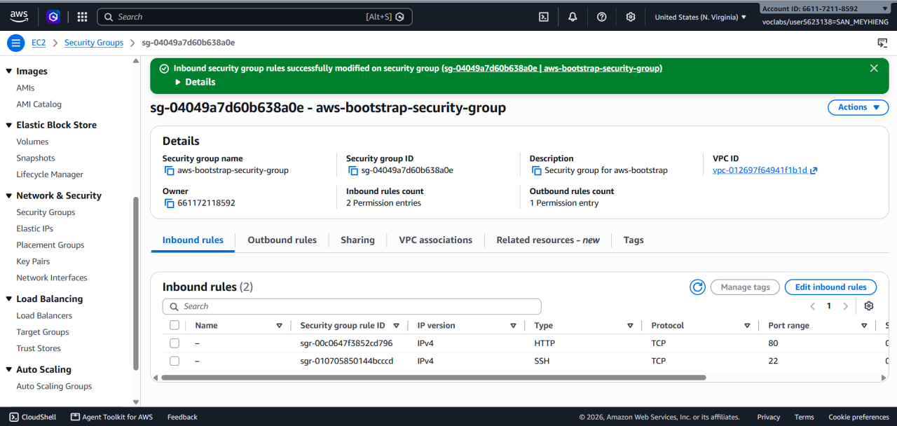
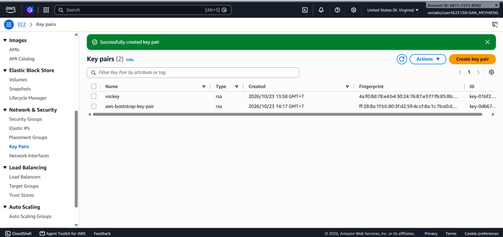
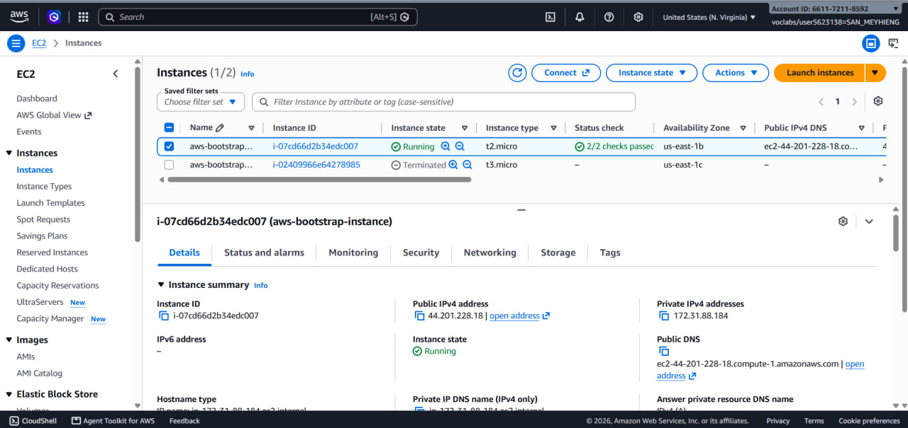
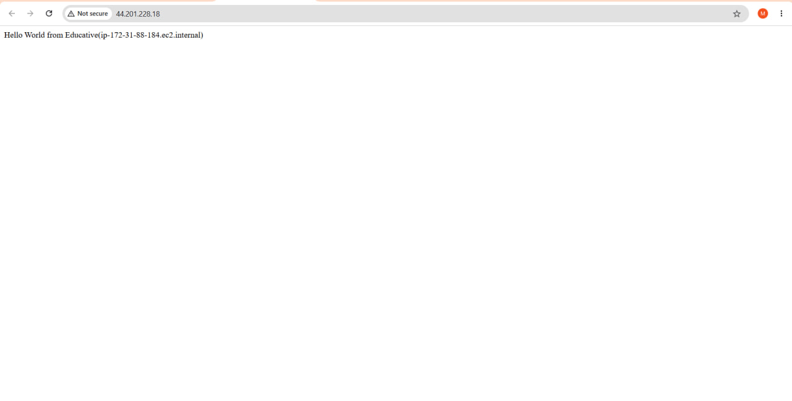
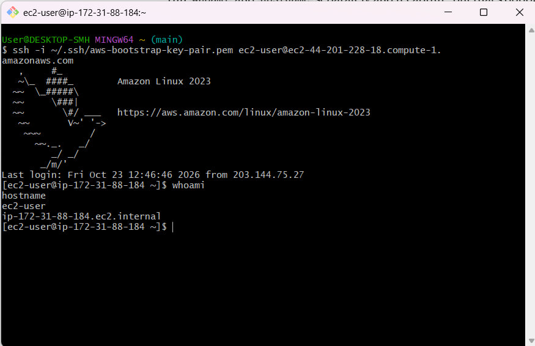
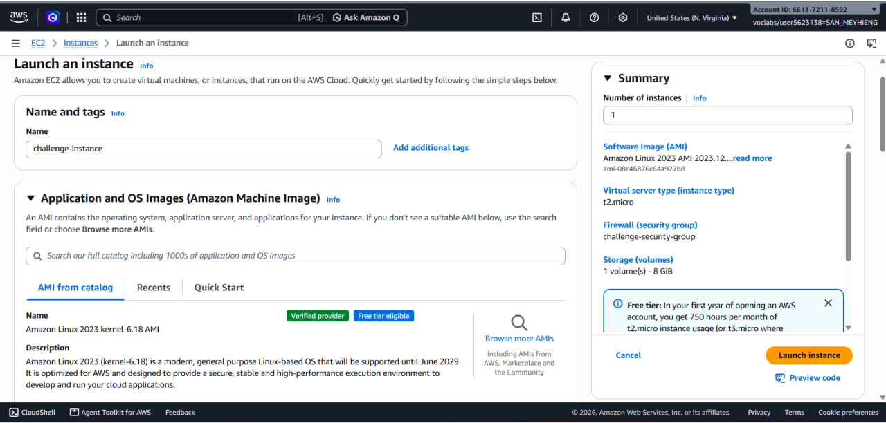
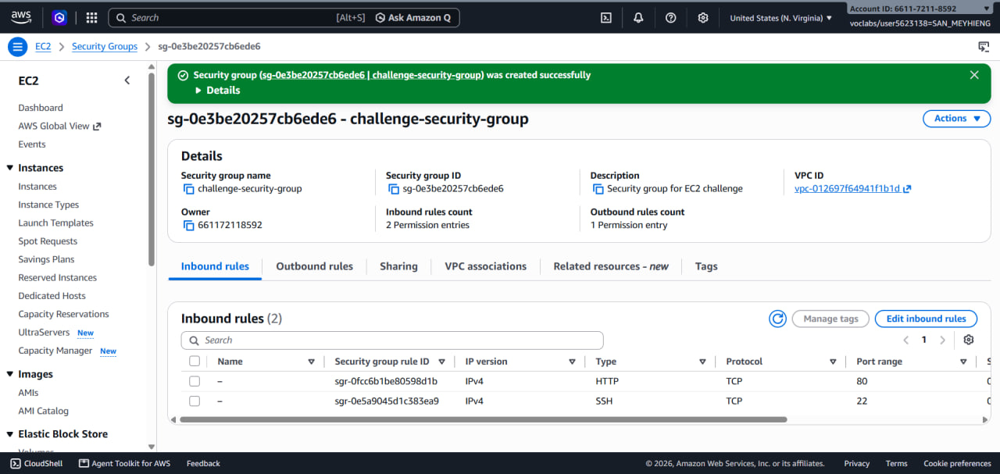
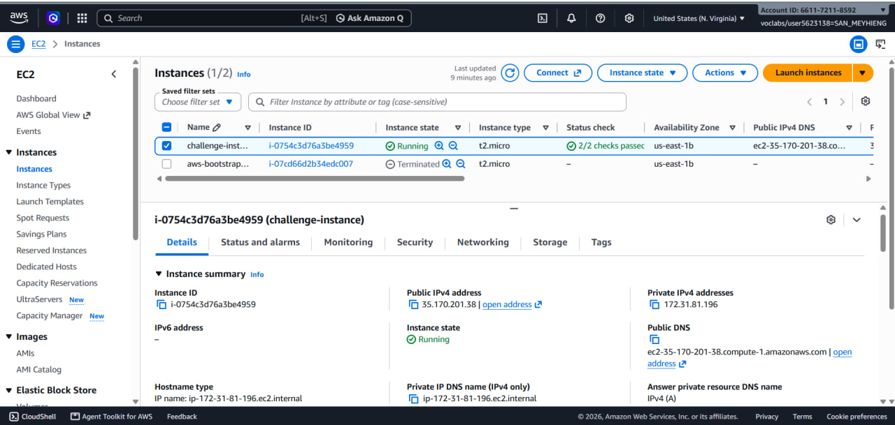
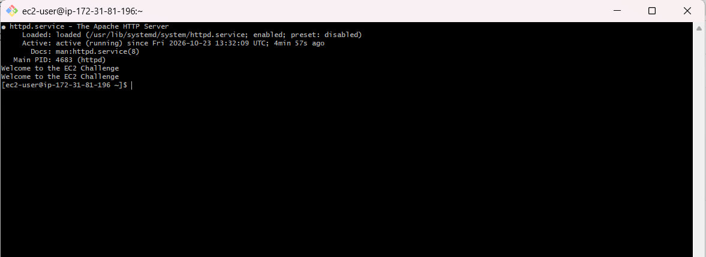
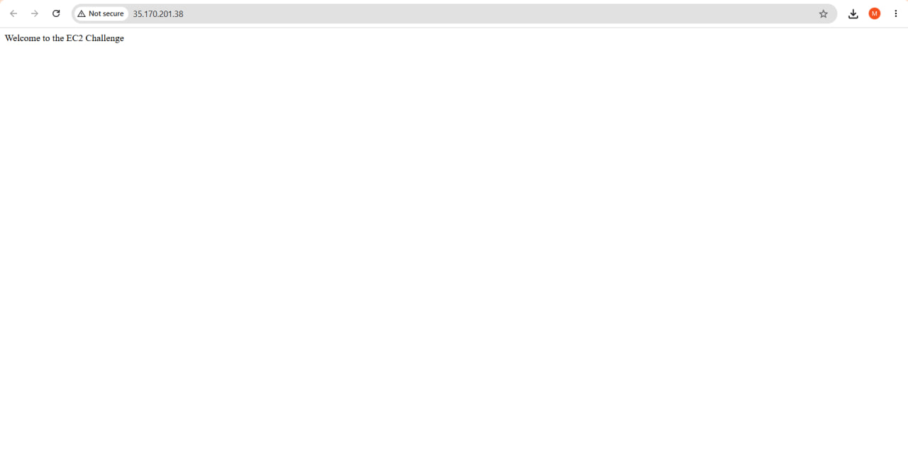

# Cloud Lab 1 Submission: Amazon EC2

- **Student name:** SAN Meyhieng
- **Student ID:** e20220677
- **Learner Lab user name:** Meyhieng
- **Date completed:** 23 Oct 2026

---

## Part 1.1: An Amazon EC2 Walkthrough

### Security group


### Key pair


### Instance details


### Browser test


### SSH connection


---

## Part 1.2: Set Up an EC2 Web Solution (Challenge)

### Launch configuration


### Security group


### Instance


### Commands I ran
```bash
ssh -i ~/.ssh/challenge-key-pair.pem ec2-user@ec2-35-170-201-38.compute-1.amazonaws.com
sudo dnf install -y httpd
sudo systemctl start httpd
sudo systemctl enable httpd
echo "Welcome to the EC2 Challenge" | sudo tee /var/www/html/index.html
curl localhost
```



### Browser


---


