# Cloud Lab 4 Submission: Amazon VPC with Public and Private Subnets

* Student name: SAN Meyhieng
* Student ID: e20220677
* Learner Lab user name: SAN_MEYHIENG
* Date completed: 6 Nov 2026

## Part 1: VPC and internet gateway
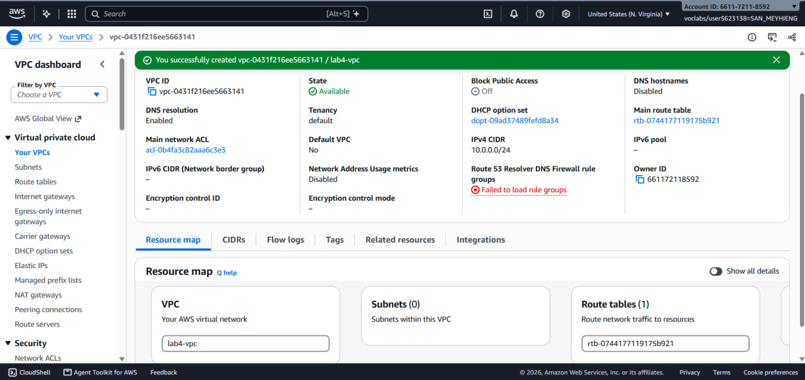
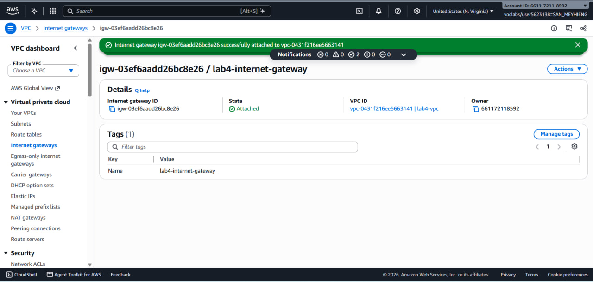

## Part 2: Public subnet
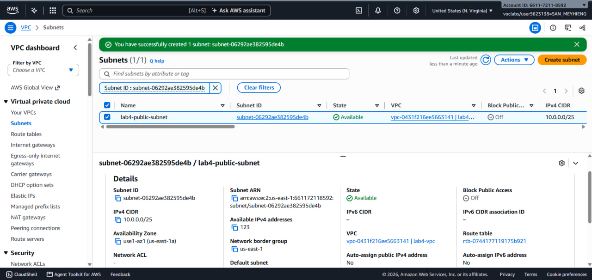
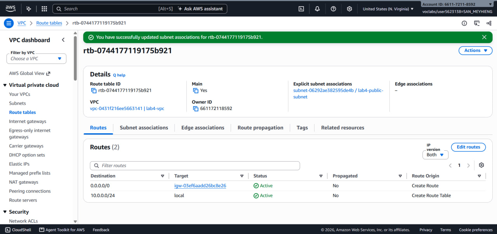
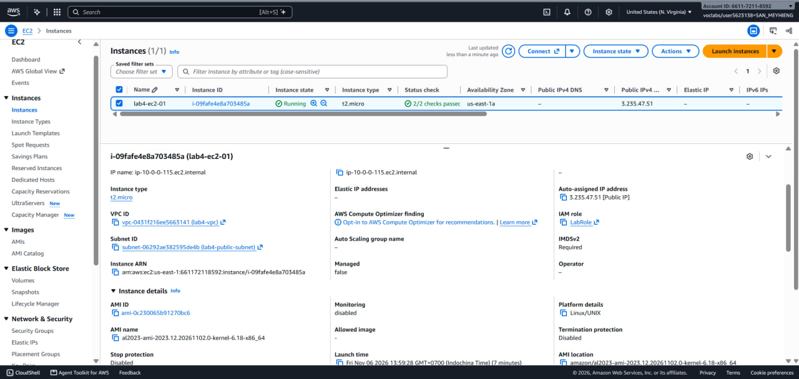
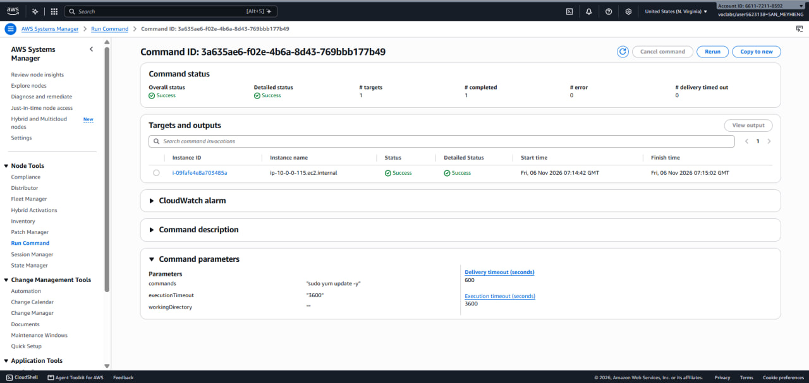

## Part 3: Private subnet
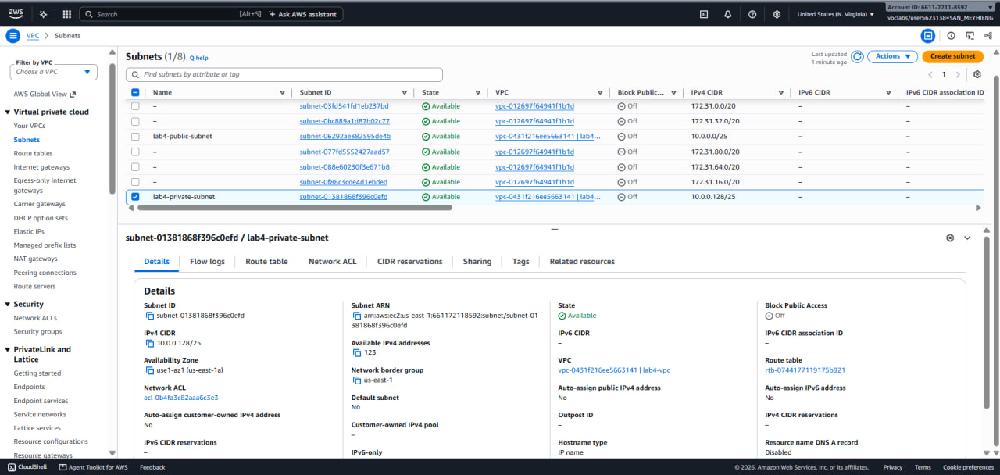
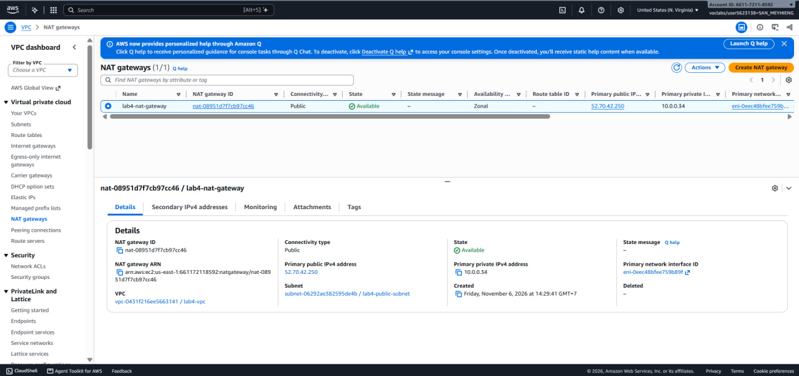
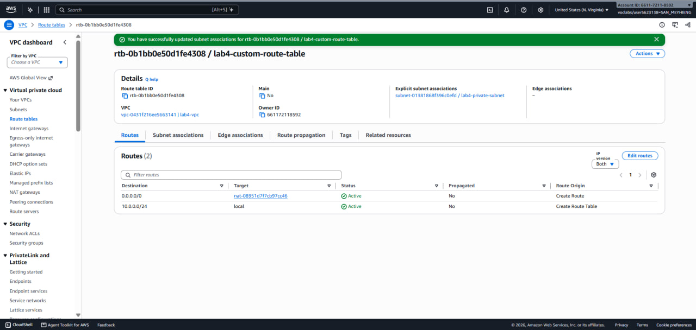
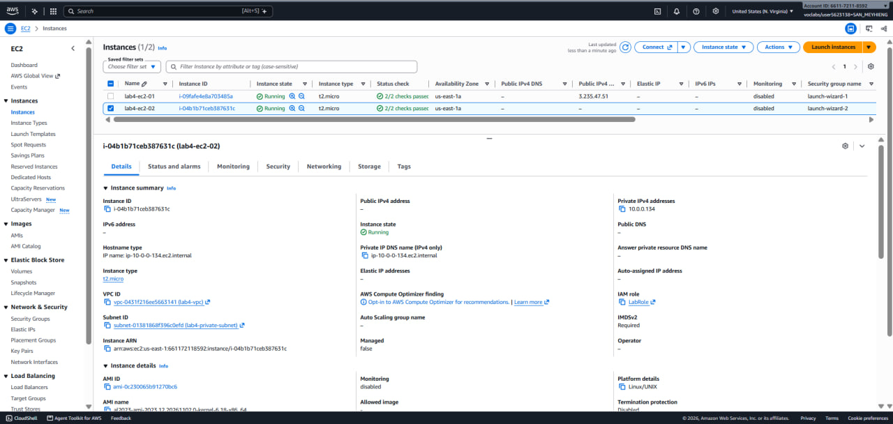
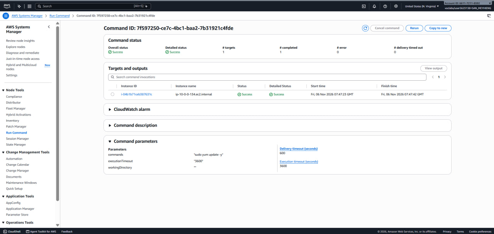

## Problems and how I solved them
* The NAT gateway form offered a new "Regional" mode. I chose "Zonal" so the NAT gateway sits in lab4-public-subnet, as the lab describes.
* lab4-ec2-01 was launched with Amazon Linux 2023 instead of Amazon Linux 2. The command sudo yum update -y worked the same way.

## Clean up
* Both EC2 instances terminated.
* NAT gateway deleted and the Elastic IP released.
* Internet gateway detached and deleted.
* lab4-vpc deleted.
